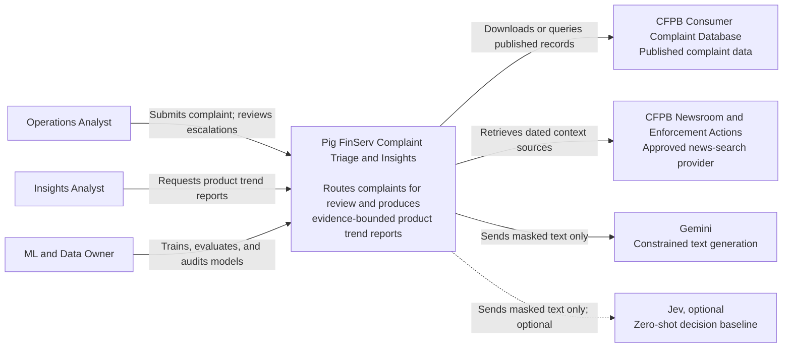
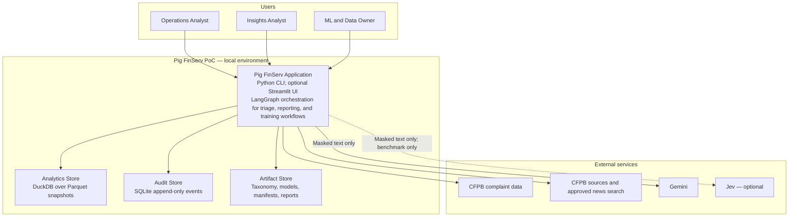
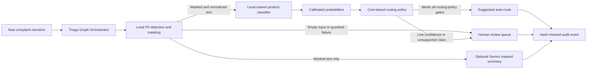
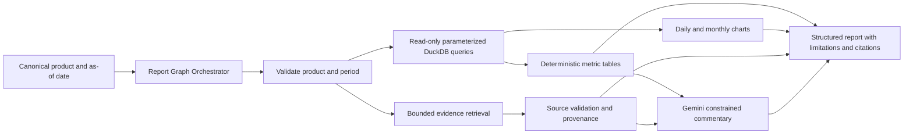

# Pig FinServ Architecture

**Status:** SDD v1 draft — implementation is not authorized until this package is approved.
**Audience:** Technical reviewers, ML/data owners, and operators.
**Scope:** Proof of concept; no production integrations or customer communications.

## 1. Architectural goals

Pig FinServ must demonstrate two capabilities without allowing generated text or external providers to make untraceable decisions:

1. Route a new complaint to a product team using a locally trained, calibrated classifier and escalate uncertain cases to a human.
2. Produce a product-level trend report whose numbers and charts come from deterministic queries, while external sources provide only attributable context.

The architecture prioritizes privacy, auditability, reproducibility, graceful degradation, and a reviewable five-day PoC scope over autonomous behavior or distributed-system complexity.

## 2. Key decisions

| Decision | Choice | Rationale |
| --- | --- | --- |
| Primary decision engine | Local supervised product classifier | The challenge requires a trained classifier; it is reproducible and remains under project control. |
| Generated text | Gemini, only after PII masking | Useful for summaries and commentary, but never for routing labels or metric calculation. |
| Optional decision model | Jev as zero-shot benchmark/second opinion | A closed product taxonomy fits a typed choice model; it must be evaluated locally and never replace the trained model. |
| Orchestration | Explicit LangGraph state machines | Makes states, tool permissions, failure paths, and audits inspectable. |
| Analytics | Parquet snapshots queried with DuckDB | Fast local analytical SQL without operating a database server. |
| Audit persistence | Local SQLite application-enforced, hash-chained event store | Provides tamper-evident integrity checks without claiming tamper-proof storage. |
| Delivery surface | CLI required; Streamlit deferred | A CLI is sufficient, testable, and reproducible. A UI may be added after the required path is complete. |
| External context | CFPB first-party sources plus a bounded configurable news-search adapter | Preserves source provenance and prevents free-form browsing. |

## 3. C4 System Context

**Question:** Who uses Pig FinServ and which systems does it depend on?

Pig FinServ owns classification policy, metric calculations, chart data, and report structure. External services do not receive raw narratives and cannot query the local data store, select SQL, or directly route a complaint.

## 4. C4 Container View

**Question:** What independently runnable applications and data stores comprise the PoC?

The PoC intentionally remains one application. Internal services are components, not separately deployed containers. All local data paths are ignored by Git; committed repository content is configuration, source, tests, documentation, and small synthetic fixtures only.

## 5. Component View: triage

The classifier makes the prediction; the routing policy makes the action. Generated summaries are supplemental and may fail without blocking a safe triage result. A failed audit write prevents an automatic route and sends the case to review.

## 6. Component View: reporting

Metrics and charts are complete before any generated prose is requested. On retrieval or Gemini failure, the report is rendered as metrics and charts with a visible note that external commentary is unavailable.

## 7. Trust boundaries and failure policy

| Boundary | Data allowed to cross | Prohibited | Failure behavior |
| --- | --- | --- | --- |
| Complaint input to local guard | Raw narrative, in memory only | Logging/exporting raw narrative | Stop external calls; create minimal failure audit event. |
| Local guard to Gemini/Jev | Masked, length-limited text; typed task payload | Raw PII, secrets, database rows, tool credentials | Omit optional output; route to review if triage safety is affected. |
| Application to DuckDB | Fixed query template and typed parameters | LLM-composed SQL, unvalidated identifiers | Return metrics error; no generated numeric substitute. |
| Application to news adapter | Bounded product/topic query and configured date window | Complaint narrative, arbitrary URLs, credentials in prompts | Render deterministic report without external context. |
| Application to audit store | Fingerprint, masked/minimized data, versions, decisions | Raw narrative and API keys | Block automatic route; retain an application health error outside the event record. |

## 8. Operational quality attributes

- **Privacy:** external providers receive masked text only; raw narratives are not stored by normal logging.
- **Safety:** uncertainty and guardrail failures fail closed to human review.
- **Reproducibility:** snapshot, taxonomy, model, threshold, query, prompt, and report identifiers are recorded.
- **Interpretability:** analysts see the predicted label, confidence, action, threshold version, and data/report limitations.
- **Resilience:** triage remains safe without an LLM; reporting remains useful without retrieval or an LLM.
- **Scope discipline:** no autonomous ticketing, outbound messaging, unrestricted browsing, unrestricted SQL, or online learning.

## 9. Public PDF deliverable

`docs/architecture/pig-finserv-architecture.pdf` will be generated only after the architecture has been approved and the rendering workflow can be verified. It will contain the System Context and Container views on page one, and the two component workflows on page two. The PDF will be derived from these approved diagrams and checked for legibility before it is committed.
